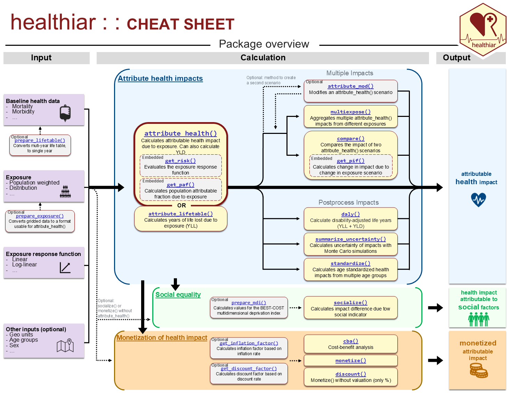

# healthiar 

Want to know as soon as a new *healthiar* version is released? See [Stay updated](#stay-updated) below.

## Introduction

*healthiar* (**health** **i**mpact **a**ssessment in **R**) is an R package to quantify and monetize the health impacts attributable to exposures, such as air pollution or noise, in a study area. Using *healthiar*, you can:

- Quantify health impacts choosing among multiple input data formats and calculation pathways:

   - Exposure data as single value or as distribution
   
   - Relative risk or absolute risk
   
   - Fixed-shape or user-defined exposure-response functions
   
   - Single or age-specific baseline health data (life table approach)

- Iterate across geographical units

- Compare scenarios

- Include and summarize uncertainties

- Monetize health impacts or perform cost-benefit analyses adjusting for inflation and discounting

- Consider social inequalities in the assessment and stratify the results

## Getting started 

You have different materials to learn about the R package `healthiar`.

### Cheat sheet
Have a quick and visual look at the [cheat sheet](https://swisstph.github.io/healthiar/articles/cheatsheet.html):

### Vignette
Read the vignette (~ package manual) *intro_to_healthiar*, which you can access:

a) on the [package website](https://swisstph.github.io/healthiar/articles/intro_to_healthiar.html) (recommended)

b) in the R console: Run `vignette("intro_to_healthiar")`

c) in the web browser: Run `browseVignettes("healthiar")` in the R console and the page will open up in your browser

### Function documentation
See the function help pages for information about specific functions. You can access the function documentation of e.g. the function `attribute_health` by

a) going to the [reference page of the package website](https://swisstph.github.io/healthiar/reference/index.html)

b) running `?attribute_health` in the R console (with `healthiar` loaded)

### Video
Watch a 45-minute video from an online international workshop (30 September 2025), which can be found [here](https://team.swisstph.ch/s/aN_wN5MUTAS3bwEkWvtvaQ). 
The slides of the presentation can be found [here](https://github.com/SwissTPH/healthiar/tree/master/varia/Workshops_and_demos/workshop).

### Stay updated
We regularly improve *healthiar* and publish a new [GitHub release](https://github.com/SwissTPH/healthiar/releases) every time a new version reaches CRAN. To make sure you don't miss one:

- **Watch releases**: on the [GitHub repo](https://github.com/SwissTPH/healthiar), click *Watch* > *Custom* > tick *Releases only*, so you get notified without being flooded by every issue or discussion.

- **Star the repo**: click *Star* on the [GitHub repo](https://github.com/SwissTPH/healthiar) to bookmark it and help others discover *healthiar*.

- **Subscribe via RSS/Atom**: if you prefer a feed reader, subscribe to [https://github.com/SwissTPH/healthiar/releases.atom](https://github.com/SwissTPH/healthiar/releases.atom).

- **Check the changelog**: see what changed in each version on the [changelog](https://swisstph.github.io/healthiar/news/index.html).

## Installation
We recommend frequently installing the newest *healthiar* version. 
Please note that **`healthiar` requires R version 4.2.0 or higher**. 
There are two options to install *healthiar*:

a) **From CRAN**: Run the following command in R:  
`install.packages("healthiar")`

b) **From GitHub (most recent version)**: Run the following commands 
in R:

1.- Install the package `remotes` (if not already installed):  
`install.packages("remotes")`

2.- Install `healthiar`: 
`remotes::install_github(repo = "SwissTPH/healthiar", build_vignettes = TRUE, dependencies = TRUE)`

Note that you may be prompted to install or update additional package dependencies 
required by `healthiar`.

**After installation**, do not forget to load the package by running the call 
`library(healthiar)`. 

## Citation
If you use *healthiar* in your work, please cite our paper in the Journal of Open Source Software (JOSS): [healthiar: An R package to quantify and monetize health impacts attributable to (environmental) exposure](https://doi.org/10.21105/joss.10599).

To get the full reference and the BibTeX entry, run `citation("healthiar")` in R.

*healthiar* can alternatively be cited through its [GitHub repository](https://github.com/SwissTPH/healthiar/blob/master/CITATION.cff) or its [Zenodo archive](https://doi.org/10.5281/zenodo.18220360), but we encourage you to cite the above-mentioned
JOSS paper.

## Disclaimer and licence 
By using *healthiar*, you confirm that you agree with the following disclaimer and terms of the licence:

a) Disclaimer: The R package *healthiar* is provided "as is", without warranty of any kind. The developers are not liable for the results obtained with it.

b) License: Available [here](https://github.com/SwissTPH/healthiar?tab=GPL-3.0-1-ov-file).

## Contributions
We welcome your contributions! 
Do you want to report a bug, provide code or just ask a question or leave a comment? 
Please read and follow the guidelines of our [guide for contributions](https://github.com/SwissTPH/healthiar?tab=contributing-ov-file).
By contributing to *healthiar*,
you agree to abide by our [code of conduct](https://github.com/SwissTPH/healthiar?tab=coc-ov-file).

## Presenting *healthiar*
If you would like us to present *healthiar* at a conference, lecture or training, please contact us: [alberto.castrofernandez@swisstph.ch](mailto:alberto.castrofernandez@swisstph.ch).

## Use of AI
Parts of the development of *healthiar* were assisted by the artificial 
intelligence (AI) tool [Claude](https://claude.com/product/claude-code) (Anthropic).
For this reason, Claude appears in the list of GitHub contributors.
All AI-assisted changes were reviewed and approved by the *healthiar* developers.

## Acknowledgements
*healthiar* was developed under the framework of the EU project BEST-COST. BEST-COST was funded by the European Union’s Horizon Europe programme under Grant Agreement No. 101095408.

Special thanks to our community members who submitted bug reports, 
suggested improvements, and provided valuable feedback to refine this package. 
Here are some of them in alphabetical order:
Adrian Aebi, Gaia Corbetta, Federico Cussotto, Brecht Devleesschauwer, Georgia Dyer, 
Nicole Engelmann, Aletta Karsies, Sasha Kohmenkho, Heli Lehtomäki, 
Matthias Lochman, Enrico Pisoni, David Rojas Rueda, 
Jörg Sintermann and Maciek Strak.

